<p align="center">
  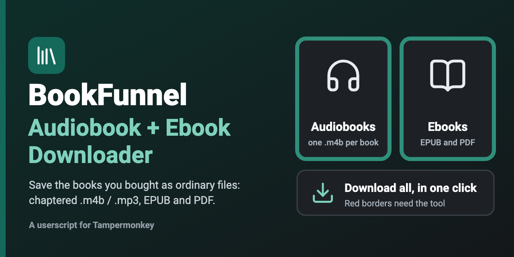
</p>

<p align="center">
  <a href="https://github.com/MankeyDoodle/BookFunnel-Audiobook-Ebook-Downloader/actions/workflows/ci.yml"></a>
  <a href="LICENSE"></a>
  
  
</p>

# BookFunnel Audiobook + Ebook Downloader

**Version 1.0.2** (first public release: 1.0.0).

Save the books you **bought** from BookFunnel as ordinary files you keep:
audiobooks as one chaptered `.m4b` (or `.mp3`, or titled chapter files), ebooks
and PDFs exactly as BookFunnel serves them. It works from your own logged-in
session, needs no terminal, and does not re-encode anything.

## What this is, and what it is not

I made this because the BookFunnel app has far fewer accessibility and
quality-of-life features than the audiobook and ebook apps I use every day, and I
wanted to read and listen to books I had paid for in the apps that work for me.

**It is**
- a tool for **personal use** by people who have **their own BookFunnel account**;
- a way to save a book you can already open and play in that account as an
  ordinary file, so your own reader, screen reader or audiobook app can use it;
- open source, with no server: everything runs in your own browser.

**It is not**
- **a hack or a security exploit.** It finds no vulnerability and does not
  decrypt, crack or defeat any encryption. It does not bypass a login, a payment
  or an access check: it only works while you are signed in to an account that
  already has the book;
- reaching into anything your account cannot already open. The addresses it
  uses are the ones the BookFunnel page and player already load for your
  signed-in account, because they need them to deliver or play the book. The
  tool reads those and saves the files;
- a way to share books. It hosts nothing and uploads nothing, and the files are
  for you. Please do not share, resell or redistribute them or the links;
- meant to undermine authors, or to override an author's choice about
  downloads. Some authors offer a book only inside the BookFunnel app. This
  project is for personal use and accessibility. If you would like a download for
  a book that does not offer one, ask the author or BookFunnel support;
- affiliated with or endorsed by BookFunnel.

See the [disclaimer](#disclaimer-and-responsible-use) below.

## Install

1. Install a userscript manager. This project is developed and tested with
   **[Tampermonkey](https://www.tampermonkey.net/)** in Chrome. Other managers
   that provide `GM_xmlhttpRequest` and `GM_download` may work but are untested.
2. Install the script, from either place:
   - **Greasy Fork:** <https://greasyfork.org/en/scripts/602959-bookfunnel-audiobook-ebook-downloader>
   - **This repository:** [`bookfunnel-downloader.user.js`](https://github.com/MankeyDoodle/BookFunnel-Audiobook-Ebook-Downloader/raw/main/bookfunnel-downloader.user.js)
     (Tampermonkey offers to install it when you open the raw file)
3. Open your library at <https://my.bookfunnel.com>, or any book's player or
   reader page. A **📚 Download** pill appears in the corner.

Updates come through the userscript manager. Release notes are in
[CHANGELOG.md](CHANGELOG.md).

## How to use

All screenshots are from a real library. Book titles, authors and covers are
blurred or replaced.

### 1. Open your library

Go to <https://my.bookfunnel.com>. Every book gets a coloured border and a key
appears in the corner:

- **Red** — BookFunnel offers this book only inside its own app (no Download
  button in the library). The panel works on its player page like any other book.
- **Green** — downloads normally.

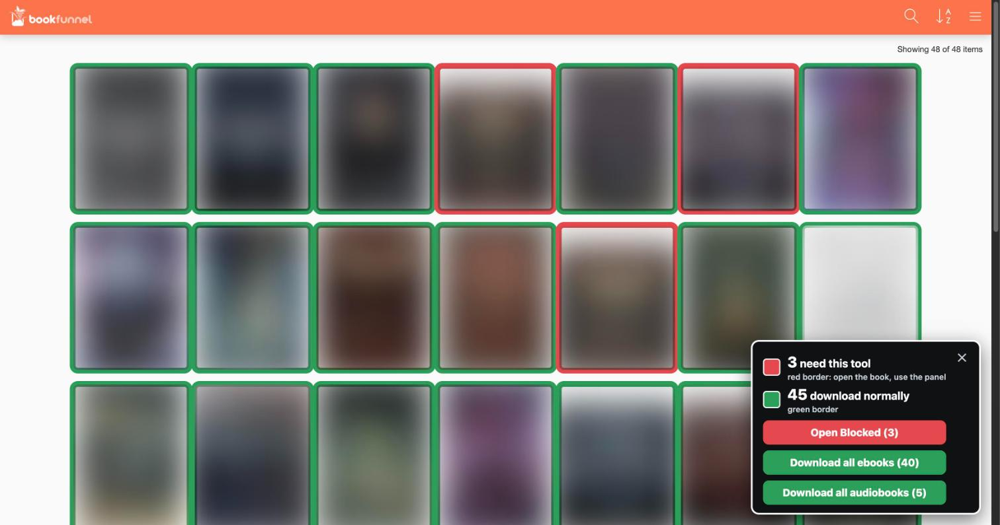

### 2. Download one ebook

Open the book (its reader or delivery page). The panel lists every format
BookFunnel offers. Tick the ones you want:

| All formats ticked | Two ticked | One ticked, after **Download** |
|---|---|---|
| 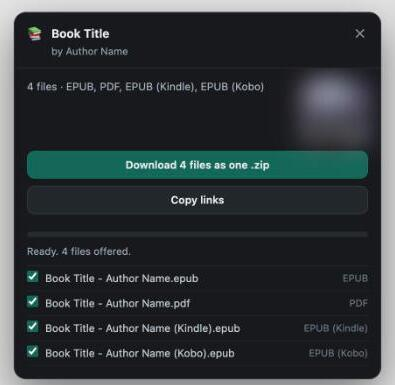 | 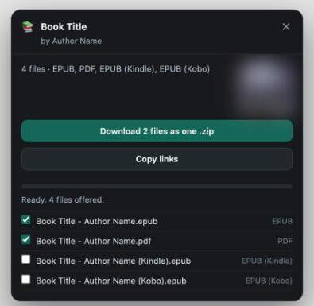 | 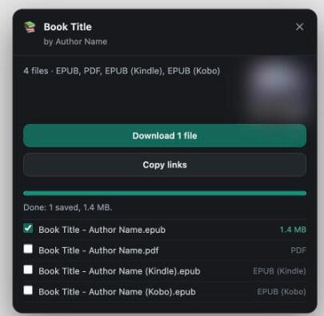 |

One ticked file is saved on its own. Several are saved together in a single
`.zip`, so your Downloads folder stays tidy.

### 3. Audiobooks with no Download button

Click **Open Blocked** in the key, or open a red-bordered book yourself. The
player page gets the panel. Pick one:

- **MP3** or **M4B** — one file for the whole book, with chapter marks, tags and
  the cover (M4B is the one most audiobook apps prefer);
- **Separate titled MP3s, in a folder (.zip)** — every chapter as its own file.

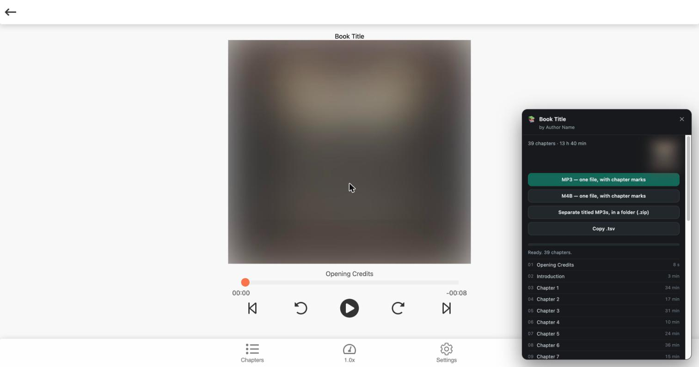

When it finishes, the panel says exactly what was saved:

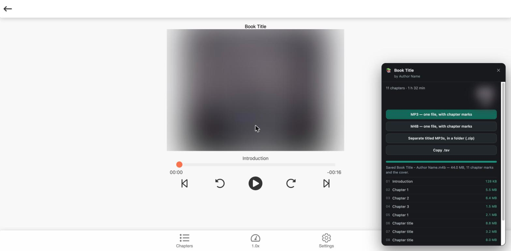

### 4. Download everything at once

The key has **Download all ebooks** and **Download all audiobooks** for every
green book. The first click only arms the button (this can be a lot of data);
click again to start.

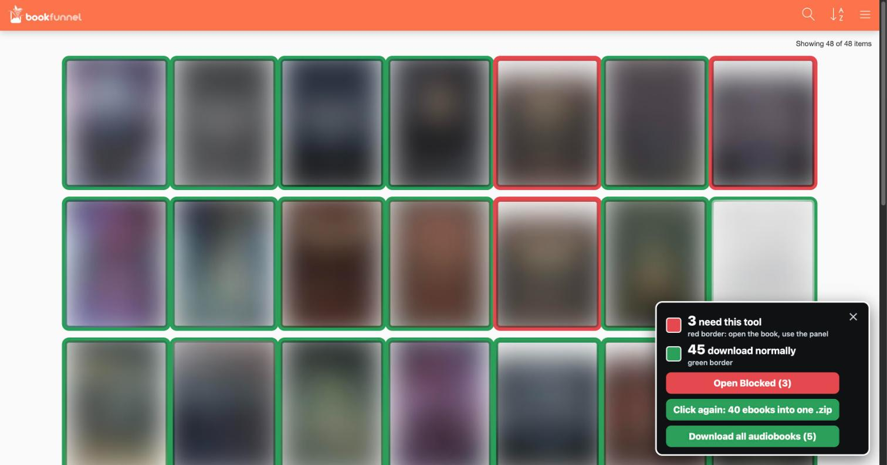

**All ebooks** saves one standard EPUB per book (the PDF when that is all there
is) in a single `.zip`.

| Running | Finished |
|---|---|
| 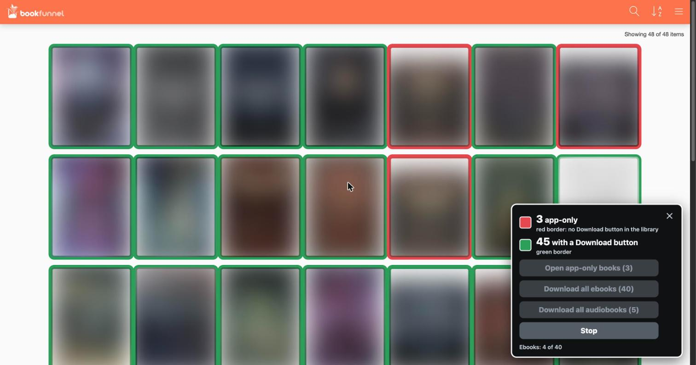 |  |

**All audiobooks** saves one chaptered `.m4b` per book, one book at a time.

| Running | Finished |
|---|---|
| 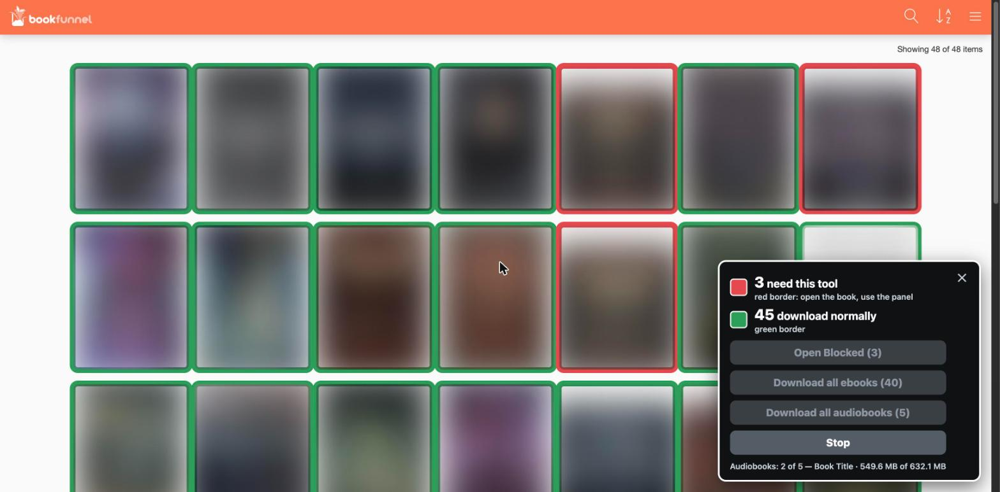 | 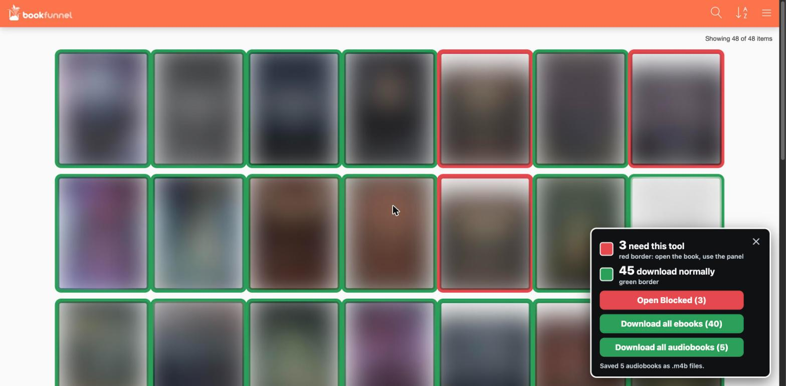 |

**Stop** ends a run after the file in flight, and **Retry failed** picks up what
did not arrive.

### 5. What you end up with

An example of the files, with made-up names:

```text
Downloads/
  Example Book - Jane Author.m4b              one chaptered audiobook, with cover
  Another Book - Jane Author.m4b
  BookFunnel ebooks.zip                       40 ebooks, one standard EPUB each
  Sample Novel - Sam Writer.epub              a single ebook saved on its own
```

Open `BookFunnel ebooks.zip` (macOS Archive Utility opens it) and you get the
plain `.epub` and `.pdf` files, named `Title - Author`.

And this is Chrome's own download list after the two bulk runs: three of the
`.m4b` audiobooks (names blurred) and the ebooks `.zip`.

<p align="center">
  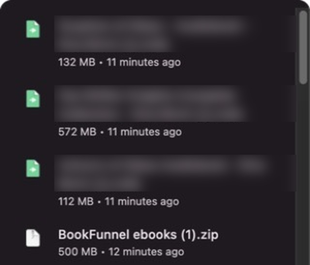
</p>

## Good to know

- **You need your own BookFunnel account and books you have access to.** It does
  not bypass a login, a payment or an access check, and it decrypts nothing. It
  reads the track list and links the page already loads for your signed-in
  account.
- **"Unable to expand" in Archive Utility?** Fixed in this release: EPUBs are
  compressed inside the `.zip`, because macOS Archive Utility cannot open a zip
  that holds another zip uncompressed.
- **A download manager that ignores file names** saves audiobooks under a random
  code. That is why the script builds the files itself and saves them under
  their proper names.
- **Please respect authors.** Keep what you bought for your own use.
  See the [disclaimer](#disclaimer-and-responsible-use).

---

## Two ways in

- **A userscript** for your browser — handles audiobooks *and* ebooks, needs no
  terminal, and works where BookFunnel gives you a player or a reader page.
- **A Python pipeline** for audiobooks — builds tagged `.m4b` files for Plex,
  Apple Books, Prologue or Audiobookshelf, with duration checks.

You need your own BookFunnel login and a book your account has access to. It does
not bypass a login, a payment or an access check, and it does not decrypt
anything: it reads the track list and the links the page already loads in your
own signed-in session.

---

## Browser userscript

Once installed (see [Install](#install)), open any
book you have access to and a **📚 Download** pill appears in the corner; it
opens the book, lists what BookFunnel offers, and saves it.

| Page | What you get |
|---|---|
| `play.bookfunnel.com/<id>` | one chaptered `.mp3` or `.m4b`, or every chapter as a titled `01 - Title.mp3` in a `.zip` folder, plus `cover.jpg` |
| `read.bookfunnel.com/<id>` | the EPUB, Kindle EPUB and Kobo EPUB for that book |
| `read.bookfunnel.com/pdf/<id>` | the PDF (or whatever format the page serves) |
| `my.bookfunnel.com/<id>/download` | every format on the delivery page |
| `pr.bookfunnel.com/<code>` | every format on that delivery link, sign-in not needed |
| audiobooks shipped as one archive | `Title - Author.zip` with all the audio, plus any sample MP3 |

Everything goes to your browser's **Downloads** folder, like any ordinary
download. There is no folder picker and no extra permission to grant — the
script hands each file to the browser and lets the browser save it.

Audiobooks get three buttons:

- **MP3 — one file, with chapter marks** — every chapter concatenated into one
  `.mp3`, with an ID3v2.3 tag carrying the title, author, cover and a `CHAP`
  frame plus a `CTOC` table for each chapter. Players that read chapter marks
  (Plex, Audiobookshelf, foobar2000, Poweramp, VLC) show the chapters.
- **M4B — one file, with chapter marks** — the same MP3 frames muxed into an
  `.m4b` (MP4 container) with a Nero `chpl` chapter list and an iTunes `meta`
  atom. Native for Apple Books, Prologue and Audiobookshelf.
- **Separate titled MP3s, in a folder (.zip)** — every chapter as its own
  `01 - Title.mp3`, each tagged with its title, the author, the book and a track
  number (`1/40`) plus the cover, in one `<Title> - <Author>.zip` that unpacks to
  a folder of that name (with a `cover.jpg`). The files are named and tagged by
  the script, not by the download manager: for a file on another site some
  managers ignore the requested name and save it under the address's own, which
  for these chapters is a UUID, with no folder and no title. Like the one-file
  options, nothing is saved until every chapter is in, and the whole book is held
  in memory while it is zipped.

Ebooks, PDFs and archives list every format on the page with a tick box beside
each (all ticked to start; click a row to toggle it). The **Download** button
says what it will do:

- **one file ticked** — saved on its own, nothing else.
- **several ticked** — fetched and stored in a single `<Title> - <Author>.zip`
  (the cover image goes inside it as `<Title> - <Author>.jpg`), so Downloads
  gets one tidy item instead of a pile of loose files. A userscript cannot
  create a real folder; a `.zip` is the closest thing. Nothing is written until
  every ticked file has arrived, so **Retry failed** refetches only the missing
  ones and then makes the `.zip`.
- **nothing ticked** — the button is disabled.

On your library page (`my.bookfunnel.com`) every book gets a coloured border:
**red** for the ones BookFunnel offers only inside its own app (no Download button
in the library; open the book and use the panel), and **green** for the ones that
download normally. A small key in the corner shows the counts and can
be dismissed with its ✕. The key's **Open Blocked** button opens every red book's
player page in its own background tab, ready for the panel.

The key also has **Download all ebooks** and **Download all audiobooks** for the
green books, each needing a second click to confirm. Ebooks: one standard EPUB
per book (the PDF when that is all there is; no Kindle or Kobo copies) in a
single `BookFunnel ebooks.zip`. (An EPUB is itself a zip, and macOS Archive Utility cannot expand a zip that holds another zip uncompressed, so the EPUBs are compressed inside; PDFs and images are stored as they are.) Audiobooks: one chaptered **`.m4b` per book**
(`<Title> - <Author>.m4b`), one at a time. BookFunnel serves these as a `.zip` of
chapter MP3s; the script fetches it, joins the chapters without re-encoding
(chapter marks named from the files) and saves a single file. A book that cannot
be joined (chapters of mixed sample rate or channels) is saved as its `.zip`
under its own name instead, and the result says so. Handing the address to the
download manager instead does not work: some managers ignore the requested name
and save a random code with no extension. A book too large to hold in memory
falls back to the manager, and the result says so. The sample clip is skipped, a book that fails is named in the result, and Stop
ends the run after the file in flight. Books that load later as you scroll are coloured too.

Also on the panel: **Copy links** (ebooks) or **Copy .tsv** (audiobooks, the
manifest format the Python script below reads), a **Stop** button that finishes
the files in flight, and **Retry failed** which only re-fetches what failed.

Details worth knowing:

- Signed URLs expire. A chapter URL is requested immediately before each
  download and re-requested on a `403`, so long downloads keep working.
- Every offer on the page is listed, not just the one BookFunnel's button picks:
  EPUB, Kindle EPUB, Kobo EPUB, PDF, ZIP, sample MP3s.
- The same file appears three times in BookFunnel's markup (`//host/x`,
  `bookfunnel://host/x`, and again for the desktop app); it is saved once.
- Files are named the way BookFunnel names them, with ` (Kindle)` / ` (Kobo)`
  added where two formats would otherwise collide.
- The combined audio is assembled in your browser without re-encoding: the MP3
  route concatenates each chapter's original frames and writes the ID3 chapter
  frames in front; the M4B route muxes the same frames into MP4. Nothing is
  transcoded, and chapter times are counted from the actual audio frames rather
  than the durations the manifest lists.
- BookFunnel's delivery links really do contain spaces (`…/Talons and Treason -
  After Dark - Amy Campbell.epub`). The script percent-encodes them once, so the
  browser's download API gets a URL it accepts.
- The cover is embedded in the combined `.mp3`/`.m4b` as a real picture frame,
  so it travels with the file. Separate titled MP3s carry it in each file's tag
  and in a `cover.jpg` beside them; several ebooks zipped together get it as an
  image inside the `.zip`.
- Apple Music and Finder read an `.mp3` as one long track and ignore its ID3
  chapter marks. That is the player, not the file: Plex, Audiobookshelf,
  foobar2000, Poweramp and VLC all show the chapters. For Apple Books and
  Prologue, use the `.m4b`, whose chapter list lives in an MP4 `chpl` atom.

How it works, in one line each:

- Audiobooks: the player embeds a `MANIFEST` of chapters, and
  `/<book-id>/next?chapter=N` hands back a presigned MP3 URL.
- Ebooks and PDFs: the delivery page links straight to the finished file on
  `prfiles.bookfunnel.com`, with the book's code in the path.
- Cloud reader: the reader only carries the unpacked EPUB, so the script asks
  `my.bookfunnel.com/<id>/download` for the real files.
- Archive-only audiobooks: `pr.bookfunnel.com/<code>/download_media` redirects
  to the finished `.zip`, and that is followed too.

---

## How it works

Nothing here is hidden or bypassed. BookFunnel's web player needs three things to
play a book, and it loads them into your browser while you are signed in:

1. The player page embeds a JavaScript array called `MANIFEST` with one entry per
   chapter (title and duration).
2. To play a chapter, the page calls `/<book-id>/next?chapter=N`, which returns a
   time-limited **signed address** for that chapter's audio, issued to your
   signed-in session.
3. The audio arrives as ordinary MP3 data.

This tool makes the same requests the player makes and saves what comes back as
a file you keep. For ebooks, the delivery page links to the finished `.epub` or
`.pdf`, and the tool saves that. It works only for an account that already has the
book; with no access, it gets nothing.

Signed addresses expire. If downloads start failing with HTTP 403, reload the
page or re-run `collect.js` for fresh ones; the userscript refreshes them itself.

---

## Requirements

| Tool | Why | Install (macOS) |
|---|---|---|
| `python3` | runs the downloader | `brew install python` |
| `curl` | fetches the audio | preinstalled |
| `ffmpeg` / `ffprobe` | verifies, tags, builds `.m4b` | `brew install ffmpeg` |

---

## Quick start

### 1. Build a manifest

- Sign in at <https://my.bookfunnel.com/>
- Open one of your audiobooks: `https://play.bookfunnel.com/<BOOK_ID>`
- Open the browser console
  - **Safari**: Settings → Advanced → *Show features for web developers*, then
    Develop → Show JavaScript Console
  - **Chrome**: View → Developer → JavaScript Console (Chrome may ask you to type
    `allow pasting` once)
- Edit the `IDS` array at the top of `collect.js` — one entry per book, taken
  from the URLs above — then paste the whole file into the console.
- The manifest lands on your clipboard. Save it next to these scripts as
  `tracks.tsv`.

### 2. Run it

**One MP3 per chapter** (Plex "Music" library):

```sh
python3 download.py tracks.tsv
```

**One chaptered `.m4b` per book** (Apple Books, Prologue, Audiobookshelf):

```sh
python3 download.py tracks.tsv --single --meta meta.json
```

Result:

```
Scales & Steel (The Gilded Prince, Book 1)/
  Scales & Steel (The Gilded Prince, Book 1).m4b    ← 29 chapters inside
  cover.jpg
Talons & Treason (The Gilded Prince, Book 2)/
  Talons & Treason (The Gilded Prince, Book 2).m4b  ← 39 chapters inside
  cover.jpg
```

To keep only the single files, add `--remove-chapters` — the per-chapter MP3s are
deleted **only after** the `.m4b` verifies (chapter count and total duration
checked), so a failed build never costs you the download.

---

## One file or many?

| | `--single` (.m4b) | per-chapter MP3s |
|---|---|---|
| Chapter skipping | yes, real chapter marks | one file per chapter |
| Apple Books / Prologue | native | works |
| Plex | shows **one** item per book; Plex ignores chapter marks | shows every chapter as a track |
| Audiobookshelf | native | native |
| Re-encode | yes, MP3 → AAC | none, original bytes |

The `.m4b` is a re-encode (AAC, default 96 kbps mono). That's unavoidable —
MP4 can't carry MP3 — so pick a bitrate that doesn't stack artifacts on top of
an already-lossy source. If your source is 64 kbps mono, `--bitrate 96k` is
generous; `--bitrate 64k` gives you the smallest file with roughly source
fidelity.

The MP3 route never re-encodes anything. If fidelity ever matters more than
convenience, use that.

---

## Options

```
python3 download.py [tracks.tsv] [options]

  --out DIR           where to write (default: current directory)
  --art PX            embedded cover size in pixels (default 600; 0 disables)
  --no-tag            download only, don't touch tags or art
  --flat              don't create a folder per book

  --single            build one chaptered .m4b per book
  --bitrate 96k       AAC bitrate for --single
  --remove-chapters   with --single, delete chapter MP3s after a verified build
  --meta FILE         JSON with per-book metadata (series, narrator, blurb, year)
```

Re-running is safe and cheap: already-downloaded files are skipped, so a dropped
connection just resumes.

---

## Metadata (`--meta`)

BookFunnel's player only ships chapter titles, durations and a cover. Nothing
else exists to scrape — no narrator, series, year or blurb. `meta.json` lets you
supply it, keyed by book id:

```json
{
  "g192apldg8": {
    "title": "Scales & Steel",
    "series": "The Gilded Prince",
    "part": 1,
    "narrator": "ElevenLabs AI narration, directed by the author",
    "description": "The Gilded Prince, Book 1. He was sent to cut out the monster's heart...",
    "year": "2025"
  }
}
```

Behaviour:

- `series` + `part` are folded into the album name: `Scales & Steel (The Gilded
  Prince, Book 1)`. Any existing trailing parenthetical in the title is stripped
  first so you never get two.
- `narrator` is written to the **composer** frame, which is where audiobook
  players (Prologue, Audiobookshelf) look for the narrator.
- `description` and `year` land in the standard frames.
- All keys are optional; omit `--meta` entirely and you get the plain
  `Title (Series)` naming BookFunnel itself uses.

---

## Manifest format

Tab-separated, because chapter titles legitimately contain commas and `-`.

```
<book_id>       <Title> by <Author>        <cover_url>
<track_no>      <duration_seconds>        <title>   <url_directory>   <url_file>
```

Three fields = book header. Five fields = track. Blank lines ignored. Duration is
used only for the integrity check below.

---

## What it verifies

- **Size sanity** — under 10 KB is treated as a failed request.
- **Duration match** — each file's real length from `ffprobe` is compared to what
  the player reported; a mismatch beyond 3 s prints a warning. Catches truncated
  downloads and mixed-up chapters.
- **`.m4b` chapter count and total length** — a build that doesn't match the
  manifest is reported as failed, and `--remove-chapters` will not delete the
  source MP3s.
- **Exit code** — non-zero if anything failed, so it's scriptable.

---

## Troubleshooting

| Symptom | Cause | Fix |
|---|---|---|
| Every request `HTTP 403` | presigned URLs expired | re-run `collect.js` |
| `no MANIFEST on page` | not an audiobook, or not your library | check the URL is `play.bookfunnel.com/...` |
| `.m4b` build failed, chapters intact | ffmpeg error, shown in output | fix and re-run; it resumes |
| Only some chapters found | rare | compare against the player's chapter list |
| Tags missing in Plex | agent overriding them | Library → Advanced → **Prefer local metadata** |
| Chapters invisible in Plex | Plex doesn't read chapter marks | use Prologue / Audiobookshelf, or keep per-chapter MP3s |
| *Userscript:* no 📚 pill | the page isn't one it recognises | it only runs on `play.`, `read.`, `my.` and `pr.bookfunnel.com` book pages |
| *Userscript:* “BookFunnel sent us to the sign-in page” | the request had no session | sign in at <https://my.bookfunnel.com/>, then reload |
| *Userscript:* “This page offers no download links” | the book is reader-only for your account | read it in the cloud reader; there are no files to save |

---

## Notes for Plex

- Add a **Music** library and point it at the output folder.
- Enable **Prefer local metadata**, or Plex tries to match "Chapter 1" against
  MusicBrainz and scrambles the order.
- A single `.m4b` appears as **one very long track**. Plex won't show its
  chapters; Prologue and Audiobookshelf will.
- Plex's audiobook resume is weak. On iOS, **Prologue** reads the same Plex
  library and does proper position sync, sleep timers and bookmarks.

---

## Files

| File | Purpose |
|---|---|
| `bookfunnel-downloader.user.js` | the userscript: audiobooks and ebooks, in the browser |
| `collect.js` | browser console snippet → `tracks.tsv` |
| `download.py` | downloads, verifies, builds `.m4b`, tags |
| `tracks.tsv` | example manifest (2 books, 68 tracks, 24.6 h) |
| `meta.json` | example metadata for those two books |
| `test/harness.html` | mock player, delivery pages, file host and filesystem |
| `test/serve.py` | serves the harness and the saved page fixtures |
| `test/pack-check.js` | builds a real chaptered `.mp3` and `.m4b` and checks them with `ffprobe` |
| `test/parser-check.js` | runs the page parser against the saved real-site fixtures |
| `test/fixtures/` | delivery pages saved from the real site, verbatim |
| `README.md` | this file |
| `BUILD-AN-APP.md` | spec for wrapping this in a GUI app |

### Testing the userscript

```sh
python3 test/serve.py
```

Then open <http://127.0.0.1:8777/?host=pr.bookfunnel.com&path=/codetwo/download&fixture=ebook-delivery>
and press **Download** (ebooks) or **MP3 — one file, with chapter marks**
(audiobooks). There is no folder picker any more, so nothing lands in the mock
filesystem: `window.__downloads` records what went through `GM_download`,
`window.__anchorClicks` records what went through a blob link (the combined
`.mp3`/`.m4b` and the cover images), and `window.__tracks()` reports each row.
Scenarios worth cycling through:

| Scenario | Query |
|---|---|
| audiobook chapters | `?host=play.bookfunnel.com&path=/g192apldg8` |
| ebook, real markup | `?host=pr.bookfunnel.com&path=/codetwo/download&fixture=ebook-delivery` |
| PDF, real markup | `?host=my.bookfunnel.com&path=/codethr/download&fixture=pdf-delivery` |
| archive + sample, real markup | `?host=pr.bookfunnel.com&path=/codeone/download&fixture=audio-archive-delivery` |
| cloud reader → delivery page | `?host=read.bookfunnel.com&path=/k46e1gz965&delivery=ebook-delivery` |
| signed out | `?host=my.bookfunnel.com&path=/loginonly9/download` |

`window.__failOnce[n] = 1` makes file `n` answer `403` once (the retry path),
`window.__failAlways[n] = 1` keeps it failing (the failed-row path), and
`window.__useGM_download = false` exercises the blob-link fallback.

### Checking the packer and parser

Two Node scripts check the parts that are easy to get subtly wrong. The packer
needs `ffmpeg` and `ffprobe`; the parser needs nothing but Node.

```sh
node test/pack-check.js     # builds a real .mp3 and .m4b, then checks them with ffprobe
node test/parser-check.js   # runs the page parser against the saved fixtures
```

`pack-check.js` generates three tagged chapters and a JPEG cover, assembles a
combined `.mp3` and `.m4b`, and confirms with `ffprobe` that the brand, tags,
chapter marks and cover are present and that the whole file decodes. Pass
`--clean` to remove the generated files afterwards. `parser-check.js` loads the
three delivery pages under `test/fixtures/` and checks the links,
percent-encoding, de-duplication and generated file names.

---

## Disclaimer and responsible use

Use this only with **your own BookFunnel account**, for books you have access to,
for **your own personal use** on your own devices. Do not share, upload, sell or
otherwise redistribute the files or the signed links.

- **Terms and laws differ.** Saving files may go against BookFunnel's terms of
  service or an author's or publisher's wishes for particular titles, and
  copyright and anti-circumvention laws vary by country. You are responsible for
  how you use this tool and for following the laws and terms that apply to you.
- **This is not legal advice.** If you are unsure, ask a qualified professional.
- **No affiliation.** This project is independent of BookFunnel and is not
  endorsed by it.
- **No warranty.** It is provided "as is" under the [MIT License](LICENSE).
- **Authors, publishers and BookFunnel:** if you have a concern about this
  project, please [open an issue](https://github.com/MankeyDoodle/BookFunnel-Audiobook-Ebook-Downloader/issues) or contact me through my GitHub
  profile. I will read it and respond.

---

## Contributing

Bug reports and pull requests are welcome; see [CONTRIBUTING.md](CONTRIBUTING.md).
Never paste cookies, signed links or your email into an issue.

## Credits

Banner icons are from [Lucide](https://lucide.dev) (ISC license); see
[assets/CREDITS.md](assets/CREDITS.md). Licensed under the [MIT License](LICENSE).
